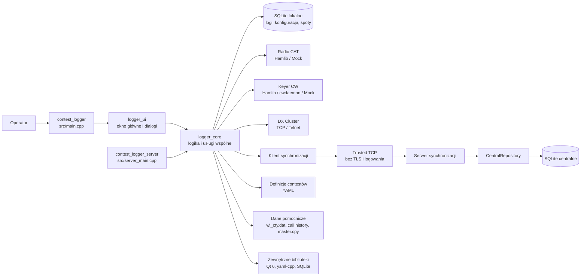

# Architektura aplikacji

Contest Logger jest aplikacją C++20 zbudowaną w CMake i opartą na Qt 6.
Wspólna biblioteka `logger_core` udostępnia logikę domenową, trwały zapis,
integracje radiowe i usługi sieciowe. Korzystają z niej dwa niezależne
programy: interfejs graficzny `contest_logger` oraz bezinterfejsowy serwer
`contest_logger_server`.

## Architektura uruchomieniowa

Interfejs graficzny i serwer używają oddzielnych baz SQLite. Klient nie otwiera
pliku bazy centralnej: komunikuje się przez trusted TCP bez szyfrowania i
uwierzytelniania klientów. W bieżących ścieżkach GUI Client/Host i serwera CLI
każda połączona stacja otrzymuje dostęp do odczytu i zapisu; sieć LAN/VPN oraz
firewall są jedyną granicą dostępu. Połączenie musi pozostać w zaufanej,
zamkniętej sieci i nie może być wystawione do Internetu. Serwer CLI oraz Host
uruchamiany z GUI są oddzielnymi trybami pracy; nie należy uruchamiać ich
równocześnie na tym samym katalogu danych. W trybie lokalnym synchronizacja
sieciowa nie jest wymagana.

## Zależności modułów

Poniższy diagram przedstawia główne zależności widoczne w modułach C++
i celach zdefiniowanych w CMake. Nie każdy moduł korzysta bezpośrednio
z każdego elementu biblioteki Qt.

```mermaid
flowchart TB
    subgraph APPS["Programy"]
        APP["contest_logger"]
        SERVER_APP["contest_logger_server"]
    end

    subgraph PRESENTATION["Warstwa prezentacji"]
        UI["logger_ui<br/>main_window"]
        DIALOGS["Dialogi<br/>new_log, operator"]
    end

    subgraph CORE["logger_core"]
        subgraph DOMAIN["Domena contestu"]
            TYPES["domain/types"]
            DEF_MODEL["domain/contest_definition"]
            DEF_LOADER["contest/contest_definition_loader"]
            ENGINE["contest/contest_engine"]
        end

        subgraph DATA["Dane i pliki"]
            SQLITE["data/sqlite_repository"]
            APP_DATA["data/application_data"]
            CENTRAL["data/central_repository"]
            IMPORT["data/log_importer"]
            EXPORT["data/log_exporter"]
            SUPPORT_DATA["data/support_data_parser"]
        end

        subgraph SERVICES["Usługi integracyjne"]
            RADIO["radio/radio_service"]
            BAND["radio/band_plan"]
            CW["cw/cw_keyer_service"]
            CLUSTER["cluster/dx_cluster_service"]
            CLIENT["network/sync_client"]
            SERVER["network/sync_server"]
            SECRET["network/secret_store"]
        end
    end

    subgraph DEPS["Biblioteki i magazyny"]
        QT["Qt 6<br/>Core, Widgets, Sql, Network, SerialPort"]
        YAML["yaml-cpp"]
        HAMLIB["Hamlib (opcjonalna)"]
        LOCAL_DB[("SQLite lokalne")]
        CENTRAL_DB[("SQLite centralne")]
        YAML_FILES["Definicje contestów<br/>pliki YAML"]
        SUPPORT_FILES["Dane pomocnicze<br/>CTY, historia znaków"]
    end

    APP --> UI
    APP --> SQLITE
    UI --> DIALOGS
    UI --> ENGINE
    UI --> APP_DATA
    UI --> IMPORT
    UI --> RADIO
    UI --> CLUSTER
    UI --> CW
    UI --> CLIENT
    UI --> SECRET
    DIALOGS --> DEF_LOADER
    DIALOGS --> ENGINE
    DIALOGS --> APP_DATA

    DEF_LOADER --> DEF_MODEL
    DEF_LOADER --> TYPES
    ENGINE --> DEF_MODEL
    ENGINE --> TYPES
    ENGINE --> EXPORT

    SQLITE --> DEF_LOADER
    SQLITE --> EXPORT
    APP_DATA --> DEF_LOADER
    CENTRAL --> DEF_LOADER
    CENTRAL --> ENGINE
    IMPORT --> EXPORT
    IMPORT --> BAND
    EXPORT --> ENGINE
    SERVER_APP --> SERVER
    SERVER_APP --> CENTRAL
    SERVER --> CENTRAL
    SERVER --> DEF_LOADER
    CLIENT --> QT
    SECRET --> QT
    RADIO --> QT
    RADIO -. "gdy dostępna" .-> HAMLIB
    CW --> QT
    CW -. "gdy dostępna" .-> HAMLIB
    CLUSTER --> QT
    SQLITE --> LOCAL_DB
    CENTRAL --> CENTRAL_DB
    DEF_LOADER --> YAML
    APP_DATA --> YAML_FILES
    DEF_LOADER --> YAML_FILES
    SUPPORT_DATA --> SUPPORT_FILES
    UI --> QT
    DIALOGS --> QT
```

Podział bibliotek z CMake:

- `logger_core` zawiera domenę, zapis danych, loader definicji i usługi
  integracyjne. Łączy Qt Core, Sql, Widgets, Network i SerialPort oraz
  `yaml-cpp`. Obsługa Hamlib jest dodawana tylko wtedy, gdy biblioteka
  została włączona i wykryta.
- `logger_ui` zawiera główne okno i zasoby Qt; linkuje `logger_core`.
- `contest_logger` łączy punkt wejścia aplikacji z `logger_ui`.
- `contest_logger_server` łączy punkt wejścia serwera z `logger_core`, bez
  zależności od głównego okna.

## Odpowiedzialności modułów

| Moduł | Rola |
|---|---|
| `domain` | Wspólne typy i model definicji contestu. |
| `contest_definition_loader` | Wczytywanie i walidacja definicji YAML. |
| `contest_engine` | Walidacja QSO, duplikaty, numery seryjne, punkty i mnożniki. |
| `sqlite_repository` | Lokalny zapis logów, migracje schematu i kopie danych. |
| `central_repository` | Kanoniczne dane serwera, zdarzenia synchronizacji i rewizje. |
| `application_data` | Katalogi danych aplikacji, ustawienia i wbudowane definicje. |
| `log_importer` / `log_exporter` | Import oraz walidowany eksport ADIF i Cabrillo. |
| `support_data_parser` | Import historii znaków, `master.cpy` i `wl_cty.dat`. |
| `radio_service` / `band_plan` | Sterowanie CAT, status radia i mapowanie pasm. |
| `cw_keyer_service` | Nadawanie, kolejka komunikatów i providerzy keyera CW. |
| `dx_cluster_service` | Połączenie TCP/Telnet, odbieranie i przechowywanie spotów. |
| `sync_client` / `sync_server` | Klient i serwer synchronizacji trusted TCP używany przez GUI i CLI. |
| `secret_store` | Magazyn sekretów zachowany dla ścieżek TLS/token w kodzie; nie jest używany w bieżącej konfiguracji GUI/CLI. |
| `ui` | Okno główne, formularze operatorskie i interakcja z usługami. |

## Przepływ danych

### Lokalna praca z logiem

1. `application_data` przygotowuje katalog danych, ustawienia i definicje YAML.
2. `contest_definition_loader` wczytuje i sprawdza definicję wybraną dla logu.
3. Interfejs przekazuje QSO do `contest_engine`, który waliduje wymianę,
   rozpoznaje duplikaty i wylicza punkty oraz mnożniki.
4. `sqlite_repository` zapisuje QSO i stan logu. Przy edycji lub imporcie
   dane są ponownie walidowane i przeliczane.
5. `log_exporter` sprawdza końcowe rekordy i zapisuje Cabrillo lub ADIF.

### Synchronizacja centralna

Klient zachowuje lokalną bazę i trwałą kolejkę operacji do wysłania. Po
rejestracji stacji bez poświadczeń przez trusted TCP przesyła zmiany do
serwera, który zapisuje je transakcyjnie przez `central_repository`. Serwer
jest źródłem kanonicznego
stanu centralnego; klienci pobierają kolejne rewizje i aktualizują lokalny
stan. Operacje są ponawiane idempotentnie, a konflikty przekazywane do
jawnego rozstrzygnięcia przez operatora. Numer seryjny wymagający nowej
rezerwacji musi być przydzielony przez serwer; potwierdzona rezerwacja może
zostać użyta offline.

## Powiązane dokumenty

- [Instrukcja użytkownika](USER_GUIDE.md)
- [Format definicji contestów](CONTEST_DEFINITIONS.md)
- [Stan i ograniczenia synchronizacji](../NETWORKING.md)
- [Budowanie i wydawanie](BUILD_AND_RELEASE.md)
