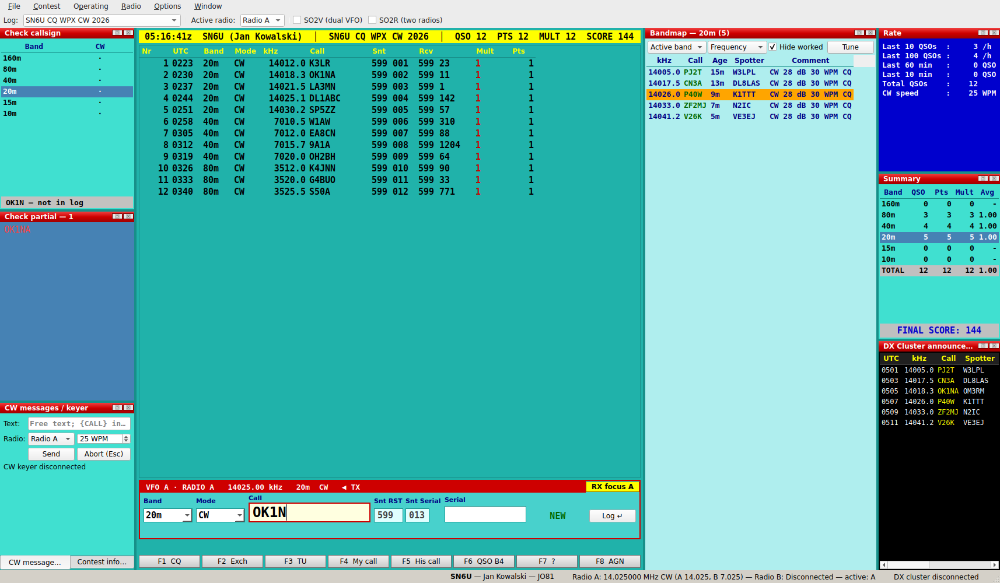
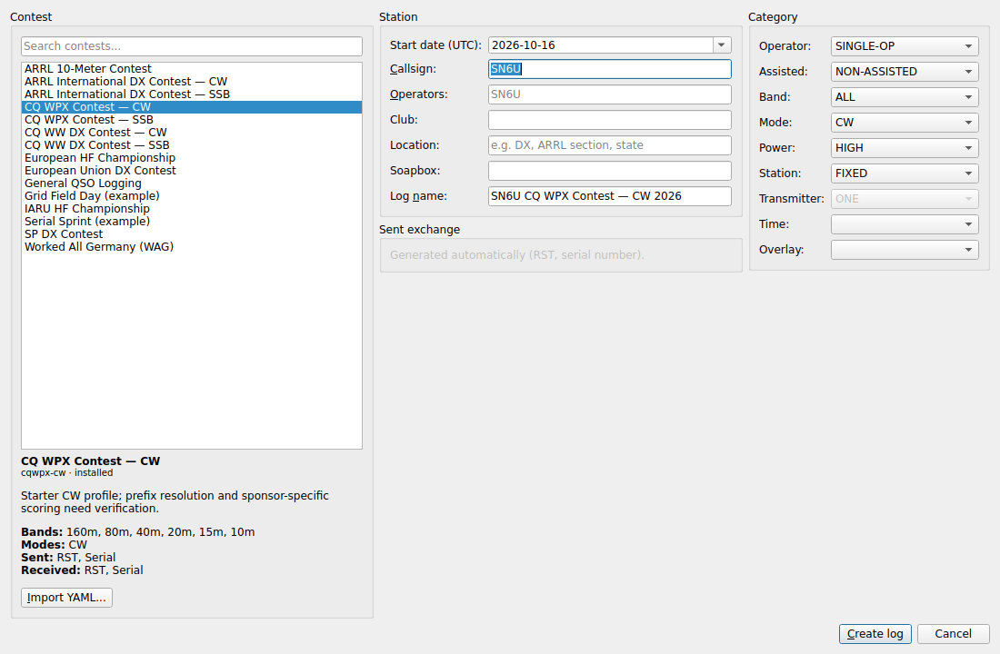
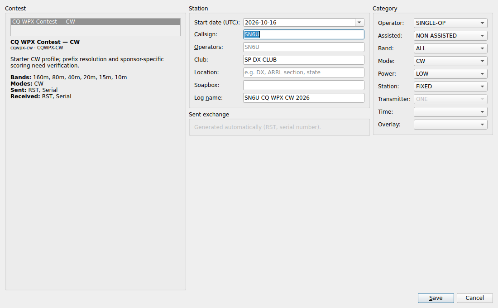
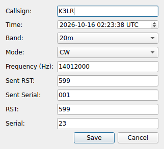
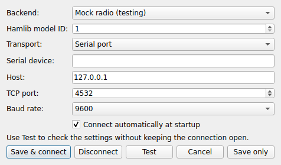
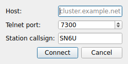
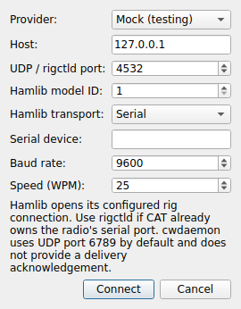
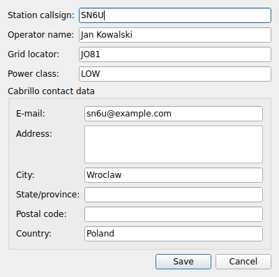

# Contest Logger — dokumentacja użytkownika

Wersja dokumentu: 0.1.0 (zgodna z `project(VERSION 0.1.0)` w `CMakeLists.txt`).

Contest Logger to wieloplatformowy (Linux, Windows) logger zawodów
krótkofalarskich napisany w C++20/Qt 6. Układ okna i sposób pracy są wzorowane
na DXLog: centralne okno logu, panel wprowadzania QSO, klawisze F1–F8,
bandmapa, okna Check callsign / Check partial, statystyki i podsumowanie
wyniku. Dane przechowywane są w bazie SQLite, a reguły zawodów — w plikach YAML.

## Spis treści

1. [Instalacja i uruchomienie](#1-instalacja-i-uruchomienie)
2. [Pliki programu i ich położenie](#2-pliki-programu-i-ich-położenie)
3. [Szybki start](#3-szybki-start)
4. [Okno główne](#4-okno-główne)
5. [Nowy log i właściwości logu](#5-nowy-log-i-właściwości-logu)
6. [Wprowadzanie i edycja QSO](#6-wprowadzanie-i-edycja-qso)
7. [Radio (CAT), SO2V i SO2R](#7-radio-cat-so2v-i-so2r)
8. [DX cluster i bandmapa](#8-dx-cluster-i-bandmapa)
9. [Keyer CW i komunikaty F1–F8](#9-keyer-cw-i-komunikaty-f1f8)
10. [Dane pomocnicze (call history, Master.SCP, wl_cty.dat)](#10-dane-pomocnicze)
11. [Eksport Cabrillo 3.0 i ADIF](#11-eksport-cabrillo-30-i-adif)
12. [Kopie zapasowe i odtwarzanie](#12-kopie-zapasowe-i-odtwarzanie)
13. [Menu — pełna lista poleceń](#13-menu--pełna-lista-poleceń)
14. [Skróty klawiszowe](#14-skróty-klawiszowe)
15. [Opcje konfiguracji (QSettings)](#15-opcje-konfiguracji-qsettings)
16. [Przykłady konfiguracji](#16-przykłady-konfiguracji)
17. [Ograniczenia i funkcje niezaimplementowane](#17-ograniczenia-i-funkcje-niezaimplementowane)
18. [Rozwiązywanie problemów](#18-rozwiązywanie-problemów)
19. [Regenerowanie zrzutów ekranu](#19-regenerowanie-zrzutów-ekranu)

Powiązane dokumenty:

- [CONTEST_DEFINITIONS.md](./CONTEST_DEFINITIONS.md) — pełny opis formatu
  definicji zawodów YAML,
- [BUILD_AND_RELEASE.md](./BUILD_AND_RELEASE.md) — budowanie, pakowanie, Hamlib,
  macierz testów sprzętowych,
- [NETWORKING_OPERATIONS.md](./NETWORKING_OPERATIONS.md) — instalacja i obsługa
  serwera synchronizacji, TLS, tokeny, backup i odzyskiwanie,
- [../NETWORKING.md](../NETWORKING.md) — protokół, stan implementacji
  i ograniczenia synchronizacji,
- [../TODO.md](../TODO.md) — lista zadań projektu.

---

## 1. Instalacja i uruchomienie

### Wymagania

- CMake ≥ 3.21, kompilator C++20 (GCC, Clang, MSVC 2022),
- Qt 6 (moduły Core, Widgets, Sql z driverem SQLite, Network; Test dla testów),
- yaml-cpp,
- opcjonalnie Hamlib (sterowanie CAT i CW przez Hamlib).

### Budowanie na Linuksie (Ubuntu)

```sh
sudo apt install cmake ninja-build g++ qt6-base-dev qt6-tools-dev \
  libqt6sql6-sqlite libyaml-cpp-dev libhamlib-dev
cmake -S . -B build -G Ninja -DCMAKE_BUILD_TYPE=Release
cmake --build build
ctest --test-dir build --output-on-failure
./build/contest_logger
```

Budowanie bez Hamlib: `-DLOGGER_ENABLE_HAMLIB=OFF`. Instrukcja dla Windows
(vcpkg, `windeployqt`) znajduje się w [BUILD_AND_RELEASE.md](./BUILD_AND_RELEASE.md).

### Opcje wiersza poleceń

| Opcja | Działanie |
|---|---|
| `--help`, `-h` | Wyświetla pomoc. |
| `--restore-backup <plik.sqlite>` | Odtwarza zweryfikowaną kopię bazy i kończy działanie (program musi być zamknięty). |

### Opcje CMake

| Opcja | Domyślnie | Znaczenie |
|---|---|---|
| `LOGGER_ENABLE_HAMLIB` | wykrywane | Włącza/wyłącza obsługę Hamlib. |
| `HAMLIB_INCLUDE_DIR`, `HAMLIB_LIBRARY` | — | Ręczne wskazanie Hamlib. |
| `BUILD_TESTING` | `ON` | Buduje testy (`ctest`). |
| `CONTEST_LOGGER_BUILD_DOC_TOOLS` | `OFF` | Buduje narzędzie `doc_screenshots` do generowania zrzutów ekranu dokumentacji. |

## 2. Pliki programu i ich położenie

Program używa nazwy organizacji i aplikacji `ContestLogger`. Konkretne katalogi
wyznacza Qt (`QStandardPaths::AppDataLocation`):

| Dane | Linux | Windows |
|---|---|---|
| Baza danych | `~/.local/share/ContestLogger/ContestLogger/contest-logger.sqlite` | `%APPDATA%\ContestLogger\ContestLogger\contest-logger.sqlite` |
| Kopie automatyczne | `…/backups/automatic-RRRR-MM-DD.sqlite` | jw. |
| Pobrane `master.scp`, `wl_cty.dat` | katalog danych aplikacji | jw. |
| Ustawienia (QSettings, INI) | `…/config/ContestLogger/ContestLogger.ini` | jw. |
| Definicje zawodów YAML | `…/contests/*.yaml`, `…/contests/*.yml` | jw. |

Przy pierwszym uruchomieniu, również po instalacji pakietu, program tworzy
katalog danych, bazę, plik konfiguracji i podkatalog `contests`. Dawne ustawienia
z `~/.config/ContestLogger/ContestLogger.conf` (Linux) lub rejestru
`HKEY_CURRENT_USER\Software\ContestLogger\ContestLogger` (Windows) są jednorazowo
kopiowane do nowego pliku INI. Oryginały pozostają bez zmian.

Pliki call history i list znaków wczytane „z pliku” **nie są kopiowane** —
program zapamiętuje ich ścieżki i wczytuje je przy każdym starcie.

Wbudowane definicje zawodów (15 plików z `contests/examples/`) są wkompilowane
w program i kopiowane do podkatalogu `contests`, jeśli ich brakuje. Istniejące
pliki nie są nadpisywane. Program odczytuje z tego katalogu pliki `.yaml` i `.yml`
przy starcie oraz otwieraniu **New log**. Można tam dopisać własne definicje
lub zmodyfikować istniejące. Nowe logi korzystają z definicji na dysku; zapisane
logi zachowują swoje reguły w bazie. Błędne pliki i powtórzone identyfikatory
są zgłaszane komunikatem. Obie opcje importu YAML zapisują definicję w tym
samym katalogu.

## 3. Szybki start

1. **Options → Operator and station…** — wpisz swój znak, imię, lokator, klasę
   mocy oraz dane kontaktowe do Cabrillo (e-mail, adres).
2. **Radio → Radio A CAT settings…** — skonfiguruj radio (Hamlib lub *Mock* do
   testów) i kliknij **Save & connect**.
3. **File → New log…** (`Ctrl+N`) — wybierz zawody z listy, sprawdź znak,
   kategorie Cabrillo i wymianę nadawaną, kliknij **Create log**.
4. Wpisz znak w polu **Call**, przejdź spacją do pól wymiany, zatwierdź
   `Enter`.
5. Po zawodach: **File → Export Cabrillo…** — nagłówek Cabrillo 3.0 zostanie
   wypełniony automatycznie.

## 4. Okno główne



Elementy okna (od lewej, od góry):

| Element | Opis |
|---|---|
| Pasek narzędzi | **Log** — wybór aktywnego logu; **Active radio** — Radio A/B; **Run / S&P** — tryb pracy; **SO2V (dual VFO)**, **SO2R (two radios)**. |
| Żółta linia statusu | Czas UTC, znak (i operator), nazwa logu, liczba QSO, punkty, mnożniki i wynik. |
| Okno logu (środek) | Kolumny `Nr, UTC, Band, Mode, kHz, Call, Snt, Rcv, Mult, Pts`. Nowe mnożniki oznaczone na czerwono. Dwuklik otwiera edycję QSO. |
| Panel wprowadzania QSO | Nagłówek z VFO/radiem, częstotliwością, pasmem, emisją i znacznikiem `◀ TX`; pola Band, Mode, Call, wymiana nadawana (Snt) i odbierana; znacznik `DUPE`/`NEW MULT`/`NEW`; przycisk **Log ↵**; przycisk **RX focus**. Aktywny panel ma czerwoną ramkę. |
| Linia komunikatów | Komunikaty dla operatora (dublety, błędy walidacji) — zamiast okien modalnych. |
| Pasek F1–F8 | Przyciski komunikatów CW; prawy klik — edycja. |
| Pasek stanu | Stacja, stan radia A/B (częstotliwości VFO), stan DX clustera. |

Okna narzędziowe (docki; można je przesuwać, odłączać i ukrywać w menu
**Window**):

| Okno | Zawartość |
|---|---|
| **Check callsign** | Siatka pasmo × emisja z zaznaczeniem, gdzie wpisany znak był już zrobiony; pod spodem stan („not in log”, dupe). |
| **Check partial** | Znaki pasujące do fragmentu wpisanego znaku z Master.SCP/MASTER.CPY, call history i logu. Biały — nowy, zielony — zrobiony na innym paśmie/emisji, czerwony — dubel, pogrubiony — dokładne trafienie. Kliknięcie wstawia znak do pola Call. |
| **Contest info** | Opis aktywnej definicji: pasma, emisje, wymiana, punktacja, mnożniki, klucz dubli. |
| **Bandmap** | Spoty: filtr pasma (aktywne/wszystkie/konkretne), sortowanie (częstotliwość/najnowsze), **Hide worked**, **Tune**. Kolumny `kHz, Call, Age, Spotter, Comment`. Pomarańczowy — spot najbliższy częstotliwości radia, szary — zrobiony. |
| **Rate** | QSO/h z ostatnich 10 i 100 QSO, liczba QSO z ostatnich 60 i 10 minut, suma QSO, prędkość CW. |
| **Summary** | Tabela per pasmo: QSO, punkty, mnożniki, średnia; wiersz TOTAL i **FINAL SCORE**. |
| **DX Cluster announcements** | Surowa, chronologiczna lista ogłoszeń clustera; dwuklik — przejście do spotu. |

**Window → Restore default layout** przywraca domyślny układ. Geometria okna
i układ docków zapisywane są przy zamknięciu programu.

## 5. Nowy log i właściwości logu

**File → New log…** (`Ctrl+N`) otwiera okno wzorowane na DXLog:



### Grupa *Contest*

- **Search contests…** — filtr listy (nazwa lub identyfikator).
- Lista zainstalowanych definicji zawodów; pod listą opis wybranej definicji
  (pasma, emisje, wymiana nadawana i odbierana).
- **Import YAML…** — import nowej definicji z pliku (patrz
  [CONTEST_DEFINITIONS.md](./CONTEST_DEFINITIONS.md)). Zaimportowana definicja
  pojawia się na liście i zostaje zaznaczona.

### Grupa *Station*

| Pole | Opis |
|---|---|
| Start date (UTC) | Data rozpoczęcia logu (domyślnie dziś, UTC). |
| Callsign | Znak używany w tym logu (wymagany, `A–Z 0–9 /`, maks. 20 znaków). Domyślnie znak z *Operator and station*. Zastępuje znak globalny, gdy log jest aktywny. |
| Operators | Lista operatorów (Cabrillo `OPERATORS`). Puste przy `SINGLE-OP` oznacza znak stacji. |
| Club | Klub (Cabrillo `CLUB`), zapamiętywany dla kolejnych logów. |
| Location | Cabrillo `LOCATION` (np. `DX`, sekcja ARRL, stan), zapamiętywane. |
| Soapbox | Cabrillo `SOAPBOX`. |
| Log name | Nazwa logu (proponowana jako `ZNAK Zawody ROK`); musi być unikalna. |

### Grupa *Category*

Wartości kategorii Cabrillo 3.0:

| Pole | Wartości |
|---|---|
| Operator | `SINGLE-OP`, `MULTI-OP`, `CHECKLOG` |
| Assisted | `NON-ASSISTED`, `ASSISTED` |
| Band | `ALL` oraz pasma z definicji zawodów |
| Mode | emisje definicji odwzorowane na `CW`, `SSB`, `RTTY`, `FM`, `DIGI`; przy kilku emisjach także `MIXED` |
| Power | `HIGH`, `LOW`, `QRP` |
| Station | `FIXED`, `PORTABLE`, `MOBILE`, `ROVER`, `ROVER-LIMITED`, `ROVER-UNLIMITED`, `EXPEDITION`, `HQ`, `SCHOOL`, `EXPLORER`, `DISTRIBUTED` |
| Transmitter | `ONE`, `TWO`, `LIMITED`, `UNLIMITED`, `SWL` (aktywne tylko dla `MULTI-OP`, w innych przypadkach `ONE`) |
| Time | puste, `6-HOURS`, `8-HOURS`, `12-HOURS`, `24-HOURS` |
| Overlay | puste, `CLASSIC`, `ROOKIE`, `TB-WIRES`, `YOUTH`, `NOVICE-TECH`, `OVER-50` |

Ostatnio użyte kategorie, klub, lokalizacja i zawody są zapamiętywane
(`newLog/*` w ustawieniach).

### Grupa *Sent exchange*

Pola wymiany nadawanej z definicji (np. strefa, DOK, moc). Pola generowane
automatycznie (RST, numer seryjny) są tylko opisane. Wartości są walidowane
według definicji — błędy blokują utworzenie logu.

### Właściwości logu

**File → Log properties…** edytuje te same dane dla aktywnego logu (bez
zmiany zawodów):



## 6. Wprowadzanie i edycja QSO

1. Wpisz znak w polu **Call** (zamieniany na wielkie litery). Na bieżąco
   aktualizują się *Check callsign*, *Check partial*, znacznik
   `DUPE`/`NEW MULT`/`NEW` i podpowiedzi z call history.
2. `Spacja` przechodzi: Call → kolejne pola wymiany odbieranej → z powrotem do
   Call (z zaznaczeniem tekstu).
3. `Enter` w polu Call lub w polach wymiany (albo przycisk **Log ↵**) zapisuje
  QSO. Dupe i błędy walidacji są wyświetlane w linii komunikatów, a kursor
  wraca do błędnego pola. Domyślnie dupe nie są zapisywane; **Operating → Allow
  logging duplicate QSOs** pozwala zachować je w logu z 0 punktami i bez nowego
  mnożnika. Opcja dotyczy także edycji QSO.
4. `Ctrl+W` czyści panel.

Pasmo i emisja ustawiane są automatycznie z CAT. Emisja z radia nadpisuje
formularz tylko wtedy, gdy zmieniła się w radiu — ręczny wybór nie jest
nadpisywany co sekundę. RST domyślnie: `59` dla fonii, `599` dla CW/emisji
cyfrowych. Wartości wymiany nadawanej są pamiętane osobno dla każdych zawodów
i każdego kontekstu (VFO A/B).

Numer seryjny jest generowany automatycznie, począwszy od `serial_start`
z definicji.

### Edycja QSO

Dwuklik w wierszu logu otwiera okno edycji:



Można zmienić znak, czas UTC, pasmo, emisję (ograniczone do definicji),
częstotliwość w Hz oraz wymianę nadaną i odebraną. Przy zapisie dane są
walidowane, dublety sprawdzane z pominięciem edytowanego QSO, a punkty
i tekst wymiany przeliczane. Błędy wyświetlane są w oknie.

## 7. Radio (CAT), SO2V i SO2R

**Radio → Radio A CAT settings…** / **Radio B CAT settings…**



| Pole | Opis |
|---|---|
Ustawienia są podzielone na karty **Connection** i **Advanced**. W części
połączenia wybierz backend, a dla Hamlib zachowano wybór **model ID** i
**transportu**. Transport szeregowy pokazuje port i prędkość; TCP pokazuje host
i port `rigctld`.

| Pole | Opis |
|---|---|
| Backend | `Hamlib` lub `Mock radio (testing)` (radio wirtualne: VFO A 14.025 MHz, VFO B 7.025 MHz). |
| Hamlib model ID | Numer modelu Hamlib (`rigctl -l`), 1–100000. `1` = Dummy, `2` = NET rigctl. |
| Transport | `Serial port` lub `TCP / rigctld`. TCP wymaga modelu `2`, model `2` wymaga TCP. |
| Serial device / Baud rate | Port, np. `/dev/ttyUSB0` lub `COM3`, i prędkość 1200–115200 (domyślnie 9600); prędkość jest sprawdzana z zakresem obsługiwanym przez model. |
| RTS / DTR | Sterowanie liniami szeregowymi Hamlib: `Unchanged` (domyślnie), `On` lub `Off`. |
| Host / TCP port | Adres `rigctld` (domyślnie `127.0.0.1:4532`). |
| Connect automatically at startup | Automatyczne połączenie przy starcie. |
| Polling interval | Odstęp odczytu statusu CAT (250 ms–5 s; domyślnie 1 s). |
| Connection timeout | Timeout Hamlib w ms (100–30000; domyślnie 3000). |

Przyciski: **Test** (jednorazowa próba: częstotliwość, emisja, liczba VFO,
dual RX), **Save & connect**, **Disconnect**, **Save only**, **Cancel**.

Komunikacja z radiem działa w osobnym wątku. Brak danych z CAT przez ponad 5 s
oznaczany jest w nagłówku panelu jako **CAT STALE**.

### SO2V (dual VFO)

Dostępne, gdy podłączone radio udostępnia dwa VFO. Zaznacz **SO2V (dual VFO)**
— pojawi się drugi panel QSO (VFO B) z własnym znakiem, pasmem, emisją,
wymianą i wskaźnikiem dubli. **RX focus A/B** wybiera aktywny odbiornik.
Radio bez jednoczesnego odbioru na dwóch VFO jest oznaczane **SO2V, no dual
RX** i wyświetlane jest ostrzeżenie. SO2V i SO2R wykluczają się.

### SO2R (dwa radia)

Skonfiguruj i połącz Radio A i Radio B, potem zaznacz **SO2R (two radios)**.
Każdy panel QSO jest kierowany do swojego radia; **Active radio** wybiera radio
dla bandmapy. Awaria jednego radia nie zatrzymuje drugiego. Nadawanie CW
automatycznie korzysta z radia aktywnego panelu QSO i jego aktywnego VFO.
Przed zmianą radia nadawczego zatrzymaj trwające CW; gdy kolejka jest pusta,
keyer przełącza połączenie automatycznie według konfiguracji docelowego radia.

## 8. DX cluster i bandmapa

**Radio → DX cluster…**



| Pole | Opis |
|---|---|
| Host | Adres serwera Telnet clustera (wymagany). |
| Telnet port | Domyślnie `7300`. |
| Station callsign | Znak do logowania (domyślnie znak stacji). |

Klient obsługuje negocjację Telnet, prompt logowania, parsowanie linii
`DX de …`, zapis spotów w SQLite (stare spoty są usuwane) oraz automatyczne
ponowne łączenie (odstęp rosnący do 30 s). Aby pracować z kilkoma clusterami,
wybierz **Radio → DX cluster…** dla każdego serwera; aktywne połączenie dla
wysyłania wybiera się nad listą ogłoszeń. **Radio → Disconnect DX cluster**
rozłącza wszystkie połączenia.

Pole nad ogłoszeniami wysyła pojedyncze komendy do wybranego połączenia, np.
`SH/DX` albo spot `DX W1AW 14025.0 CQ TEST`. Komenda nie może zawierać znaków
końca linii. Spoty można również wysyłać przez API usługi, podając znak,
częstotliwość i komentarz.

Bandmapa: `Ctrl+Up`/`Ctrl+Down` (lub `Up`/`Down` w tabeli) wybiera spot,
`Enter`, **Tune** lub dwuklik wpisuje znak do aktywnego panelu i stroi aktywne
radio. Filtry pasma, emisji i kontynentu są niezależne. Rozpoznanie kontynentu
korzysta z załadowanego `wl_cty.dat`; bez pasującego wpisu spot trafia do filtra
**Unknown**. Spoty starsze niż 1 h nie są wyświetlane.

## 9. Keyer CW i komunikaty F1–F8

**Radio → CW keyer…**



| Pole | Opis |
|---|---|
| Provider | `Mock (testing)`, `cwdaemon`, `Hamlib`. |
| Host | Host cwdaemon lub rigctld (domyślnie `127.0.0.1`). |
| UDP / rigctld port | cwdaemon: UDP `6789`; rigctld: TCP `4532`. |
| Hamlib model ID, Hamlib transport, Serial device, Baud rate | Parametry osobnego połączenia Hamlib dla CW. |
| Hamlib serial RTS / DTR | Stan linii RTS i DTR (`Unchanged`, `On`, `Off`); dostępne dla transportu szeregowego i stosowane przez Hamlib. |
| Speed (WPM) | Prędkość (domyślnie 25). |

Hamlib otwiera własne połączenie z radiem — jeśli port szeregowy jest już
zajęty przez CAT, użyj `rigctld`. Dla cwdaemon i mocka kolejny komunikat jest
wysyłany dopiero po potwierdzeniu końca nadawania; brak potwierdzenia w czasie
`oczekiwany × 3 + 3 s` zatrzymuje kolejkę z ostrzeżeniem. Dla backendów
Hamlib używających ogólnego `wait_morse` kolejka nieblokująco odczytuje PTT
z wyłączonym cache; pozwala to obsłużyć abort i rozłączenie między odczytami.
Niestandardowe callbacki Hamlib używają szacowanego czasu, dopóki ich semantyka
nie zostanie zweryfikowana.

### Nadawanie tekstu na bieżąco

`Ctrl+K` otwiera małe okno **Live CW input**, zastępujące dock
**CW messages / keyer**. Wpisywany lub wklejany tekst jest od razu kolejkowany
do nadawania, ze spacjami, bez naciskania Enter i bez rozwijania makr.
Nie wybiera się osobnego radia: używane jest aktywne radio i jego VFO
z fokusem RX; w SO2R radio wynika z aktywnego panelu QSO. Wymagana jest emisja
CW i połączony keyer. Ograniczenie cwdaemon do VFO A nadal obowiązuje.

`PageUp` zwiększa, a `PageDown` zmniejsza prędkość o 1 WPM (zakres 5–80).
W emisji CW aktualna prędkość jest widoczna przy zegarze na górnym pasku.
Skróty działają również w oknie nadawania.

Tekstu już przekazanego do keyera nie można edytować. Enter czyści widoczne
pole na kolejną linię, nie przerywając nadawania. `Esc` zatrzymuje nadawanie,
czyści kolejkę i pole; gdy nic nie jest nadawane ani zakolejkowane, `Esc`
chowa okno. Rozpoczęcie ręcznego wpisywania wyłącza Auto CQ.

### Komunikaty F1–F8

| Klawisz | Etykieta | Domyślny tekst |
|---|---|---|
| F1 | CQ | `CQ TEST {MYCALL} {MYCALL} TEST` |
| F2 | Exch | `{SENT}` |
| F3 | TU | `TU {MYCALL}` |
| F4 | My call | `{MYCALL}` |
| F5 | His call | `{CALL}` |
| F6 | QSO B4 | `QSO B4 TU` |
| F7 | ? | `?` |
| F8 | AGN | `AGN` |

Edycja pojedynczego klawisza: **Operating → Edit function key message → Fn**
lub prawy klik na przycisku Fn. Aby skonfigurować wszystkie klawisze w jednym
miejscu, wybierz **Options → CW function key messages...**. Można zmienić
etykietę i ręcznie wpisać treść CW dla każdego Fn; obsługiwane są też makra
poniżej. Przywrócenie domyślnych tekstów jest dostępne w oknie konfiguracji.
Wiadomości są zapisywane w ustawieniach aplikacji.

Makra:

| Makro | Wartość |
|---|---|
| `{CALL}` | Znak z aktywnego panelu QSO. |
| `{MYCALL}` | Znak stacji (logu). |
| `{OPERATOR}` | Nazwa operatora z ustawień stacji. |
| `{WPM}` | Aktualna prędkość keyera. |
| `{SERIAL}`, `{NR}` | Następny numer serial contestu, z uwzględnieniem szerokości pola. |
| `{SENT}` | Pełna wymiana nadawana (np. `599 013`). |
| `{NAZWA_POLA}` | Wartość pola wymiany nadawanej, np. `{SERIAL}`, `{REPORT}`, `{ZONE}`. |

Komunikaty F1–F8 są wysyłane tylko w emisji CW, z kontekstu aktywnego panelu.
`Esc` przerywa nadawanie natychmiast i czyści kolejkę.

### Run/S&P, ESM i Auto CQ

- Tryb **Run** lub **Search & Pounce (S&P)** można zmienić w menu
  **Operating** albo na pasku narzędzi; wybór jest zapamiętywany.
  Przy połączonym CAT odstrojenie VFO o więcej niż 3 kHz od częstotliwości
  z chwili włączenia RUN automatycznie przełącza tryb na S&P i wyłącza Auto CQ.
  Liczy się także przestrajanie małymi krokami; dokładnie 3 kHz nie przełącza
  trybu. Ponowne włączenie RUN lub połączenie CAT ustala nowy punkt odniesienia.
- **Enter Sends Message (ESM)** działa, gdy jest włączone w menu **Operating**,
  a aktywny panel pracuje emisją CW. **Operating → Configure ESM messages...**
  ustawia osobne sekwencje per contest; każda niepusta linia jest osobnym
  komunikatem. Domyślnie używane są treści F5 (His call) i F3 (TU). Enter w
  polu Call wysyła sekwencję Call i przechodzi do pierwszego pola wymiany.
  Enter w polu wymiany zapisuje QSO; sekwencja po zapisie jest wysyłana tylko
  po udanym logowaniu. Przy wyłączonym ESM Enter zapisuje QSO standardowo.
- **Auto CQ (F1 repeat)** jest jawnie uruchamiane z menu **Operating**.
  Działa wyłącznie w trybie Run, emisji CW, przy pustym polu Call i gotowym
  keyerze przypisanym do wybranego radia. Wysyła F1, a następne CQ kolejkuje
  po zakończeniu nadawania i 5 sekundach przerwy. Wyłącza się po przejściu do
  S&P, zmianie emisji z CW, wpisaniu znaku, przerwaniu transmisji lub utracie
  połączenia keyera.

## 10. Dane pomocnicze

Menu **File → Support data**:

| Polecenie | Działanie |
|---|---|
| Call history file… | Import CSV/TXT call history (podpowiedzi wymiany, Check partial). Można wczytać wiele plików. |
| Master callsign list from file… | Lista znaków (`MASTER.SCP`/`MASTER.CPY`, jeden znak na linię). |
| Download/update Master.SCP… | Pobiera aktualny `MASTER.SCP` z `supercheckpartial.com` (z kontrolą ETag — pobiera tylko gdy się zmienił). |
| wl_cty.dat from file… | Import bazy prefiksów CTY. |
| Download/update wl_cty.dat… | Pobiera `https://www.country-files.com/cty/wl_cty.dat`. |

CTY służy do wyświetlania kraju i stref CQ/ITU oraz rozwiązywania mnożników
DXCC/stref/kontynentów.

## 11. Eksport Cabrillo 3.0 i ADIF

### Import ADIF / Cabrillo

**File → Import ADIF / Cabrillo…** odczytuje pliki `.adi`, `.adif`, `.log`,
`.cbr` i `.cabrillo` (format jest rozpoznawany po treści).

1. Wskaż plik i wybierz **Current log** albo **Create a new log…**.
2. Przy tworzeniu logu wybierz właściwe zawody, znak i nazwę. Jeśli identyfikator
   zawodów z pliku pasuje do zainstalowanej definicji, jest wybierany automatycznie.
3. Sprawdź podsumowanie liczby importowanych i pomijanych QSO, następnie potwierdź.

Wymagana jest definicja zawodów logu docelowego. Czas QSO jest interpretowany
jako UTC. Znak stacji w rekordzie musi odpowiadać znakowi logu; jeśli ADIF
go nie zawiera, używany jest znak docelowego logu. Emisje Cabrillo `PH`, `RY`
i `DG` są mapowane na `SSB`, `RTTY` i `DATA`.

Identyczne rekordy (ten sam czas, znak korespondenta, pasmo i emisja) są
pomijane zarówno w pliku, jak i względem istniejącego logu. Inne duple według
reguł zawodów są zachowywane z zerową punktacją. Punkty są przeliczane według
definicji logu docelowego, a nadane numery seryjne są zachowywane.

ADIF obsługuje pola `RST_SENT`/`RST_RCVD`, `STX`/`SRX`,
`STX_STRING`/`SRX_STRING` oraz standardowe pola wymiany (np. `CQZ`, `STATE`,
`ARRL_SECT`, `GRIDSQUARE`). Tekst wymiany jest mapowany według kolejności pól
w definicji zawodów; działa też zapis `nazwa=wartość` eksportowany przez aplikację.
Cabrillo obsługuje wiersze `QSO:` z wymianą właściwą dla wybranej definicji
i opcjonalnym końcowym numerem nadajnika. Niejednoznaczny układ lub brak
wymaganej wymiany powoduje jawny błąd, bez zgadywania danych.

Błąd rekordu lub zapisu przerywa cały import — nie pozostawia części QSO ani
pustego nowego logu. Anulowanie potwierdzenia również niczego nie zapisuje.
Import do logu synchronizowanego korzysta ze zwykłej kolejki outbox;
stacja z dostępem tylko do odczytu nie może importować.

### Eksport

**File → Export Cabrillo…** i **File → Export ADIF…** walidują log (znaki, czas
UTC, pasmo/częstotliwość, emisję, dublety, pola wymiany) przed zapisem. Przy
błędzie istniejący plik nie jest nadpisywany; zapis odbywa się atomowo przez
plik tymczasowy.

### Skąd pochodzą pola nagłówka Cabrillo

| Pole | Źródło |
|---|---|
| `CREATED-BY` | `Contest Logger <wersja>` |
| `CONTEST` | `cabrillo.contest` z definicji YAML (np. `CQ-WPX-CW`), w przeciwnym razie identyfikator definicji wielkimi literami |
| `CALLSIGN` | znak logu (*New log*) lub znak stacji |
| `LOCATION`, `CLUB`, `OPERATORS`, `SOAPBOX`, `CATEGORY-*` | właściwości logu (*New log* / *Log properties*) |
| `CATEGORY-BAND` (brak) | jedno pasmo w QSO → to pasmo, inaczej `ALL` |
| `CATEGORY-MODE` (brak) | jedna emisja → `CW`/`SSB`/`RTTY`/`DIGI`, inaczej `MIXED` |
| `CATEGORY-POWER` (brak) | klasa mocy z *Operator and station* (`HIGH`/`LOW`/`QRP`) |
| `CATEGORY-ASSISTED`, `CATEGORY-TRANSMITTER`, `OPERATORS` (brak, `SINGLE-OP`) | `NON-ASSISTED`, `ONE`, znak stacji |
| `GRID-LOCATOR`, `NAME`, `EMAIL`, `ADDRESS` (do 6 linii), `ADDRESS-CITY`, `ADDRESS-STATE-PROVINCE`, `ADDRESS-POSTALCODE`, `ADDRESS-COUNTRY` | *Options → Operator and station* |
| `CLAIMED-SCORE` | wynik policzony według punktacji definicji |

QSO są zapisywane chronologicznie; QSO bez częstotliwości z CAT otrzymują dolną
krawędź pasma (np. `1800` dla 160 m). Emisje: USB/LSB/SSB → `PH`, RTTY → `RY`,
FT8/FT4/dane → `DG`.

ADIF zawiera znak, czas, pasmo, emisję, częstotliwość (jeśli zapisana) oraz
wymianę nadaną i odebraną.

### Okno *Operator and station*



| Pole | Klucz ustawień | Pole Cabrillo |
|---|---|---|
| Station callsign | `station/callsign` | `CALLSIGN` (gdy log nie ma własnego znaku) |
| Operator name | `station/operatorName` | `NAME` |
| Grid locator | `station/grid` | `GRID-LOCATOR` |
| Power class | `station/powerClass` | `CATEGORY-POWER` (gdy brak w logu) |
| E-mail | `station/email` | `EMAIL` |
| Address | `station/address` | `ADDRESS` |
| City | `station/city` | `ADDRESS-CITY` |
| State/province | `station/stateProvince` | `ADDRESS-STATE-PROVINCE` |
| Postal code | `station/postalCode` | `ADDRESS-POSTALCODE` |
| Country | `station/country` | `ADDRESS-COUNTRY` |

## 12. Kopie zapasowe i odtwarzanie

- **File → Back up database…** — spójna kopia online z kontrolą integralności.
- Przy starcie tworzona jest jedna automatyczna kopia dziennie
  (`backups/automatic-RRRR-MM-DD.sqlite`); przechowywane są kopie z ostatnich
  30 dni.
- Baza pracuje w trybie WAL z `synchronous=FULL`; przy starcie wykonywany jest
  `quick_check`. Uszkodzona baza nie jest po cichu zastępowana.
- Odtwarzanie (przy zamkniętym programie):

  ```sh
  contest_logger --restore-backup ~/.local/share/ContestLogger/ContestLogger/backups/automatic-2026-10-16.sqlite
  ```

  Poprzednia baza jest zachowywana obok odtworzonej.

## 13. Menu — pełna lista poleceń

| Menu | Polecenie | Skrót |
|---|---|---|
| **File** | New log… | `Ctrl+N` |
| | Log properties… | |
| | Export Cabrillo… | |
| | Export ADIF… | |
| | Import ADIF / Cabrillo… | |
| | Back up database… | |
| | Support data → Call history file… / Master callsign list from file… / Download/update Master.SCP… / wl_cty.dat from file… / Download/update wl_cty.dat… | |
| | Exit | `Ctrl+Q` |
| **Contest** | Import YAML definition… | |
| **Operating** | Wipe QSO entry | `Ctrl+W` |
| | Switch entry A/B | `Ctrl+Tab` |
| | Live CW input | `Ctrl+K` |
| | Increase / Decrease CW speed | `PageUp` / `PageDown` |
| | Run / Search & Pounce |
| | Enter Sends Message (ESM) |
| | Auto CQ (F1 repeat) |
| | Previous / Next bandmap spot | `Ctrl+Up` / `Ctrl+Down` |
| | Abort CW transmission | `Esc`, `Ctrl+Esc` |
| | Send F1 … F8 | `F1`–`F8` |
| | Edit function key message → F1…F8 | |
| **Radio** | Radio A / Radio B CAT settings… | |
| | Reconnect / Disconnect Radio A CAT, Radio B CAT | |
| | DX cluster… / Disconnect DX cluster | |
| | CW keyer… / Reconnect CW keyer / Disconnect CW keyer | |
| | Abort CW transmission | `Ctrl+Esc` (także `Esc` podczas nadawania) |
| **Options** | Operator and station… | |
| | Central network connection… | |
| | Host central server on this station… / Stop central server on this station | |
| | Create central log / import local log… (aktywny Host) | |
| | Disconnect central network | |
| | Network status and queue… | |
| | CW function key messages… | |
| **Window** | Pokaż/ukryj każde okno narzędziowe; Restore default layout | |

### Połączenie z centralnym logiem

Tryb Local pozostaje domyślny. **Options → Central network connection...**
konfiguruje adres i port serwera (domyślnie TCP 7443), token stacji, log
oraz opcjonalny plik dodatkowego CA. Certyfikat musi pasować do podanej
nazwy serwera; weryfikacji TLS nie należy wyłączać. Dostępne jest połączenie
z lokalną kopią logu, dołączenie do logu serwera lub utworzenie centralnego
logu przez administratora.

Token można opcjonalnie zapisać w Windows Credential Manager lub Linux
Secret Service. Na Linuxie potrzebne są `secret-tool` i działający Secret
Service w sesji użytkownika. Automatyczne łączenie wymaga zapisanej
konfiguracji istniejącego lokalnego logu i tokenu w magazynie systemowym;
jest domyślnie wyłączone.

**Options → Host central server on this station...** uruchamia serwer
w procesie GUI z osobną bazą, certyfikatem/kluczem PEM i plikiem poświadczeń
JSON. Host może mieć włączony autostart, ale zatrzymuje się przy zamknięciu
aplikacji. Do stałej usługi służy oddzielny `contest_logger_server`;
konfigurację opisuje [runbook](./NETWORKING_OPERATIONS.md). Nie współdziel
aktywnego pliku SQLite między komputerami.

**Disconnect central network** rozłącza Clienta bez kasowania lokalnych
logów i kolejki. Klient z uprawnieniem tylko `read` pobiera dane, ale nie
może modyfikować QSO ani rezerwować numerów. Nowy numer seryjny wymaga
potwierdzenia serwera; wcześniej potwierdzoną rezerwację można wykorzystać
offline. Synchronizacja pozostaje przed pilotażem — nie traktuj jej jeszcze
jako zatwierdzonej do pracy w zawodach.

### Status sieci i podłączone stacje

Otwórz **Options → Network status and queue...**. Oprócz lokalnego stanu
połączenia, rewizji, kolejki i rezerwacji numerów okno pokazuje podłączone
stacje wybranego logu: nazwę komputera (**Computer**), znak stacji
(**Station callsign**), operatora (**Operator**) i stan **Connected**.
Własna stacja ma oznaczenie **Connected (this station)**. Nazwa komputera
jest pobierana z systemu, a znak i operator z konfiguracji **Operator and
station...** (znak aktywnego logu ma pierwszeństwo). Zmiana tych ustawień
jest przekazywana bez ponownego łączenia.

Są to aktywne, uwierzytelnione sesje, a nie historyczna lista stacji.
UUID nadal służą do identyfikacji w protokole, ale nie są wyświetlane
w tabeli. Dla pustego opisu lub starszego klienta/serwera bez obsługi
opisów wyświetlane jest **Not provided**, nie UUID. Opisy są deklarowane
przez klientów i nie służą do uwierzytelniania.

Lista jest odświeżana po otwarciu, co 5 sekund, po zmianie stanu połączenia
oraz przyciskiem **Refresh**. Dostęp mają także klienci tylko do odczytu;
uprawnienie administratora nie jest wymagane. GUI Host korzysta z lokalnego
serwera, jeśli Client nie jest połączony z wybranym logiem. Po rozłączeniu
bez aktywnego Hosta tabela jest czyszczona z komunikatem o niedostępności,
a błąd pobrania jest pokazywany nad tabelą. Dla logu bez aktywnych sesji
pokazywana jest liczba 0.

## 14. Skróty klawiszowe

### Globalne (w całym oknie głównym)

| Skrót | Działanie |
|---|---|
| `Ctrl+N` | Nowy log |
| `Ctrl+Q` | Zakończ program |
| `F1`–`F8` | Wyślij komunikat CW Fn (tylko emisja CW) |
| `Ctrl+K` | Otwórz okno nadawania CW na bieżąco |
| `PageUp` / `PageDown` | Zwiększ / zmniejsz prędkość CW o 1 WPM (5–80) |
| `Esc` | Przerwij CW i wyczyść kolejkę; w bezczynnym oknie CW schowaj je |
| `Ctrl+Esc` | Zawsze przerwij CW i wyczyść kolejkę |
| `Ctrl+W` | Wyczyść aktywny panel QSO |
| `Ctrl+Tab` | Przełącz panel QSO A/B (SO2V/SO2R) |
| `Ctrl+Up` / `Ctrl+Down` | Poprzedni / następny spot w bandmapie |

### W panelu QSO

| Klawisz | Działanie |
|---|---|
| `Enter` | Zapisz QSO; z ESM w CW: Call wysyła F5 i przechodzi do wymiany, Enter w wymianie zapisuje QSO i po sukcesie wysyła F3 |
| `Spacja` | Następne pole wymiany odbieranej; po ostatnim — powrót do Call |
| `Tab` / `Shift+Tab` | Standardowe przejście między polami (Qt) |

### W bandmapie i oknie clustera

| Klawisz / mysz | Działanie |
|---|---|
| `Up` / `Down` | Wybór spotu |
| `Enter` | Wpisz znak spotu i nastrój radio |
| Dwuklik | jw. |

### Inne

| Miejsce | Klawisz / mysz | Działanie |
|---|---|---|
| Okno CW, pole tekstu | `Enter` | Wyślij tekst |
| Log | Dwuklik | Edycja QSO |
| Pasek F1–F8 | Prawy klik | Edycja etykiety i tekstu komunikatu |
| Check partial | Klik | Wstaw znak do pola Call |

## 15. Opcje konfiguracji (QSettings)

Wszystkie opcje są ustawiane z poziomu okien programu; tabela służy jako
odniesienie (np. do kopiowania konfiguracji między komputerami).

### Stacja — `station/*`

`callsign`, `operatorName`, `grid`, `powerClass`, `email`, `address`, `city`,
`stateProvince`, `postalCode`, `country` — patrz [rozdział 11](#okno-operator-and-station).

### Praca operatorska — `operating/*`

| Klucz | Domyślnie | Znaczenie |
|---|---|---|
| `operating/runMode` | `0` (Run) | `0` = Run, `1` = Search & Pounce |
| `operating/esmEnabled` | `false` | Włącza ESM dla paneli pracujących emisją CW |

### Radia — `radio/A/*`, `radio/B/*`

| Klucz | Typ | Domyślnie | Znaczenie |
|---|---|---|---|
| `backend` | int | `0` (Hamlib) | `0` = Hamlib, `1` = Mock |
| `transport` | int | `0` (Serial) | `0` = port szeregowy, `1` = TCP/rigctld |
| `modelId` | int | `1` | Model Hamlib |
| `devicePath` | string | — | Port szeregowy |
| `host`, `port` | string, int | `127.0.0.1`, `4532` | rigctld |
| `baudRate` | int | `9600` | Prędkość portu |
| `rtsState`, `dtrState` | int | `0` (`Unchanged`) | Linie szeregowe Hamlib: `0` = bez zmian, `1` = On, `2` = Off |
| `timeoutMs` | int | `3000` | Timeout połączenia Hamlib w milisekundach |
| `pollIntervalMs` | int | `1000` | Interwał odpytywania CAT w milisekundach |
| `autoConnect` | bool | `false` | Łączenie przy starcie |
| `radio/so2vEnabled` | bool | `false` | Stan przełącznika SO2V |

Starsze ustawienia bez grupy `A` (`radio/backend` itd.) są czytane dla Radio A.

### Keyer CW — `cw/*`

| Klucz | Domyślnie | Znaczenie |
|---|---|---|
| `cw/type` | `2` (Mock) | Provider: `0` = Hamlib, `1` = cwdaemon, `2` = Mock |
| `cw/radioIndex` | `0` | Radio CW (0 = A, 1 = B) |
| `cw/host`, `cw/port` | `127.0.0.1`, `6789` | cwdaemon / rigctld |
| `cw/wpm` | `25` | Prędkość |
| `cw/hamlib/modelId`, `transport`, `devicePath`, `baudRate`, `rtsState`, `dtrState`, `host`, `port` | jak radio | Połączenie Hamlib dla CW |
| `cw/functionKeys/F1..F8/label`, `…/text` | tabela w rozdziale 9 | Komunikaty F1–F8 |

### DX cluster — `dxCluster/*`

`host`, `port` (`7300`), `callsign` (znak stacji).

### Nowy log — `newLog/*`

`lastContest`, `CLUB`, `LOCATION`, `CATEGORY-OPERATOR` (`SINGLE-OP`),
`CATEGORY-ASSISTED` (`NON-ASSISTED`), `CATEGORY-POWER` (`HIGH`),
`CATEGORY-STATION` (`FIXED`), `CATEGORY-TRANSMITTER` (`ONE`),
`CATEGORY-OVERLAY` i pozostałe ostatnio użyte kategorie.

### Wymiana nadawana

`contest/sentExchange/<id-zawodów>/<pole>/vfo0` i `…/vfo1` — ostatnia wartość
pola wymiany nadawanej dla danego kontekstu.

### Dane pomocnicze — `supportData/*`

| Klucz | Znaczenie |
|---|---|
| `callHistory`, `callHistoryFiles` | Ostatni plik / lista plików call history |
| `masterCpy`, `masterCpyFiles` | Lista znaków z pliku |
| `masterScpPath`, `masterScpEtag` | Pobrany `master.scp` i jego ETag |
| `ctyDat` | Ścieżka `wl_cty.dat` |

### Sesja i okno

| Klucz | Znaczenie |
|---|---|
| `session/activeContestId` | Log otwierany przy starcie |
| `ui/mainWindowGeometry`, `ui/mainWindowStateV2` | Geometria i układ docków |

## 16. Przykłady konfiguracji

### 16.1 Własna definicja zawodów (YAML)

```yaml
schema_version: 1
id: sp-sprint-cw
name: SP Sprint CW (przykład)
description: Wymiana RST + numer + województwo.
bands: [80m, 40m]
modes: [CW]
cabrillo: {contest: SP-SPRINT-CW}
exchange:
  sent:
    - {name: report, label: RST, type: rst, default: "599"}
    - {name: serial, label: Nr, type: serial, generated: true, width: 3}
    - {name: province, label: Woj, type: enum, values: [B, C, D, F, G, K, L, M, O, P, R, S, T, U, W, Z]}
  received:
    - {name: report, label: RST, type: rst}
    - {name: serial, label: Nr, type: integer, min: 1, max: 9999}
    - {name: province, label: Woj, type: enum, values: [B, C, D, F, G, K, L, M, O, P, R, S, T, U, W, Z]}
scoring:
  qso_points: 1
  multipliers:
    - {type: exchange, field: province, per_band: true}
dupe_key: [callsign, band]
```

Import: **Contest → Import YAML definition…** lub przycisk **Import YAML…**
w oknie *New log*. Pełny opis kluczy: [CONTEST_DEFINITIONS.md](./CONTEST_DEFINITIONS.md).

### 16.2 Radio przez port szeregowy (Hamlib)

Okno *Radio A CAT settings*: Backend `Hamlib`, model np. `3073` (IC-7300),
Transport `Serial port`, Serial device `/dev/ttyUSB0` (Windows: `COM3`),
Baud rate `19200`, zaznaczone *Connect automatically at startup*.
Na Linuksie użytkownik musi należeć do grupy `dialout`.

### 16.3 Radio przez rigctld (współdzielenie z innymi programami)

```sh
rigctld -m 3073 -r /dev/ttyUSB0 -s 19200 -T 127.0.0.1 -t 4532
```

W programie: Backend `Hamlib`, model `2` (NET rigctl), Transport
`TCP / rigctld`, Host `127.0.0.1`, TCP port `4532`. Ten sam `rigctld` może być
użyty przez keyer CW typu Hamlib.

### 16.4 Keyer cwdaemon

```sh
cwdaemon -d ttyUSB1 -p 6789 -s 28
```

W programie (**Radio → CW keyer…**): Provider `cwdaemon`, Host `127.0.0.1`,
UDP port `6789`, Speed `28`.

### 16.5 DX cluster

Host np. `dxc.example.org` (dowolny serwer DX Spider/AR-Cluster), port
`7300`, znak `SN6U`.

### 16.6 Plik call history

```text
CALL,NAME,QTH,ZONE,EXCHANGE
SP5ZZ,ADAM,WARSZAWA,15,
DL1ABC,HANS,BERLIN,14,
K3LR,TIM,PA,5,
```

Bez nagłówka: wiersze rozdzielone spacjami w kolejności `CALL NAME QTH EXCHANGE`.
Rozpoznawane kolumny: `CALL`/`CALLSIGN`, `NAME`, `QTH`, `STATE`, `GRID`,
`SECTION`, `SERIAL`, `REPORT`, `EXCHANGE` oraz nazwy pól wymiany.

### 16.7 Fragment pliku ustawień (`…/config/ContestLogger/ContestLogger.ini`)

```ini
[station]
callsign=SN6U
operatorName=Jan Kowalski
grid=JO81
powerClass=LOW
email=sn6u@example.com
city=Wroclaw
country=Poland

[radio]
A\backend=0
A\transport=1
A\modelId=2
A\host=127.0.0.1
A\port=4532
A\autoConnect=true

[cw]
type=1
host=127.0.0.1
port=6789
wpm=28
functionKeys\F1\label=CQ
functionKeys\F1\text=CQ TEST {MYCALL} {MYCALL} TEST

[dxCluster]
host=dxc.example.org
port=7300
callsign=SN6U
```

Edytuj plik tylko przy zamkniętym programie. Wartości `cw/type`: `0` = Hamlib,
`1` = cwdaemon, `2` = Mock; `radio/A/backend`: `0` = Hamlib, `1` = Mock;
`radio/A/transport`: `0` = port szeregowy, `1` = TCP. Zalecane jest ustawianie
przez okna konfiguracji.

### 16.8 Wynikowy nagłówek Cabrillo

Dla logu z okna *New log* (CQ WPX CW, SINGLE-OP, LOW) i ustawień jak wyżej:

```text
START-OF-LOG: 3.0
CREATED-BY: Contest Logger 0.1.0
CONTEST: CQ-WPX-CW
CALLSIGN: SN6U
CATEGORY-OPERATOR: SINGLE-OP
CATEGORY-ASSISTED: NON-ASSISTED
CATEGORY-BAND: ALL
CATEGORY-MODE: CW
CATEGORY-POWER: LOW
CATEGORY-STATION: FIXED
CATEGORY-TRANSMITTER: ONE
GRID-LOCATOR: JO81
CLAIMED-SCORE: 144
CLUB: SP DX CLUB
NAME: Jan Kowalski
EMAIL: sn6u@example.com
ADDRESS-CITY: Wroclaw
ADDRESS-COUNTRY: Poland
OPERATORS: SN6U
QSO: 14012 CW 2026-10-16 0223 SN6U 599 001 K3LR 599 23
...
END-OF-LOG:
```

## 17. Ograniczenia i funkcje niezaimplementowane

### Reguły zawodów

- Wbudowane definicje to **profile startowe**, nie certyfikowane implementacje
  regulaminów. Definicje YAML obsługują warunkowe pola wymiany odbieranej
  (`required_when`), warunkowe pola wymiany nadawanej zależne od lokalizacji
  stacji (`when`) oraz uporządkowane reguły punktacji QSO
  (`qso_point_rules`). Reguły punktacji mogą uwzględniać pasmo, emisję,
  odebraną wymianę i metadane CTY; pierwsza pasująca reguła wygrywa.
- Dostępne typy mnożników to `exchange`, `prefix`, `dxcc` i `country`.
  Mnożniki DXCC/kraju oraz warunki geograficzne wymagają załadowanego
  `wl_cty.dat`; bez danych CTY wartość mnożnika może pozostać nierozwiązana.
  Prefiks WPX jest wyznaczany regułą programu, którą należy zweryfikować dla
  znaków portable.
- EU DX (`eudx.yaml`) nie ma ustawionego identyfikatora Cabrillo — eksport
  użyje `EUDX`; sprawdź wymagania organizatora.
- Kategorie Cabrillo specyficzne dla zawodów oraz zasady wysyłki logu należy
  sprawdzić przed wysłaniem.

### Log i edycja

- **Brak usuwania QSO** z poziomu programu (ani menu, ani klawisza `Delete`).
- Brak cofania (undo), wydruku i statystyk graficznych.
- Brak popupu z uzupełnianiem znaku w polu Call — podpowiedzi są tylko w
  oknie *Check partial*.
- Tabela logu nie ma sortowania (poza chronologicznym), filtrowania ani
  wyszukiwania. Okno *DX Cluster announcements* przechowuje maks. 500 ostatnich
  ogłoszeń.
- Synchronizacja centralnego logu jest wdrożona, ale niezatwierdzona do
  pracy w zawodach: pozostają pełne testy awaryjne, próba odzyskiwania
  w środowisku docelowym i pilotaż 2–3 stacji. Szczegóły w
  [NETWORKING.md](../NETWORKING.md) i [TODO.md](../TODO.md).
- ESM ma celowo podstawową regułę: CW Call/Enter wysyła F5 i przechodzi do
  wymiany, a Enter po wymianie zapisuje QSO i po sukcesie uruchamia sekwencję
  wiadomości skonfigurowaną per contest. Same sekwencje ESM nie są warunkowane
  polami wymiany.

### Radio, SO2V i SO2R

- CAT przetestowano na Hamlib Dummy i `rigctld`; testy na różnych modelach
  radia i platformach nie zostały jeszcze przeprowadzone.
- Paczka Windows (CI) jest budowana **bez Hamlib** — na Windows dostępny jest
  tylko backend Mock, chyba że zbudujesz program z własnym Hamlib.
- SO2V: trasowanie TX/keyera nie zostało zweryfikowane na sprzęcie (Hamlib CW
  przekazuje jawnie VFO A/B; TX podąża za fokusem RX i nagłówek panelu oznacza
  aktywny tor `◀ TX`. Wiadomości zachowują docelowy VFO także w kolejce.
  cwdaemon nie obsługuje wyboru VFO, więc nadawanie na VFO B jest blokowane.
  Zachowanie wymaga jeszcze potwierdzenia na fizycznym radiu/Hamlib.
- SO2R: brak przełączania audio, PTT i anten (brak obsługi sterowników SO2R
  typu OTRSP, SO2R Box itp.); CAT to nie przełączanie audio.
- Brak sterowania PTT, DVK (komunikaty głosowe) oraz komunikatów RTTY/FT8.

### Keyer CW

- Hamlib CW używa nieblokującego odczytu PTT dla backendów z ogólnym
  `wait_morse`; callbacki niestandardowe używają szacowanego czasu. To
  zachowanie wymaga jeszcze walidacji na fizycznych radiach.
- Brak obsługi WinKeyer.
- Dostępne makra CW: `{CALL}`, `{MYCALL}`, `{OPERATOR}`, `{WPM}`, `{SERIAL}`,
  `{NR}`, `{SENT}` i pola wymiany nadawanej. Nie ma jeszcze makra zwiększającego
  numer, np. `{NR}+1`.

### DX cluster i bandmapa

- Spoty starsze niż 1 h nie są pokazywane.
- Filtr kontynentu wymaga aktualnego `wl_cty.dat`; nieznane znaki można wyświetlić
  przez filtr **Unknown**.

### Inne

- Interfejs tylko w języku angielskim (brak tłumaczeń).
- Brak okna ustawień ogólnych — konfiguracja rozproszona jest po oknach
  w menu *Radio* i *Options*.
- Obsługa sprzętu (porty szeregowe, uśpienie/wybudzenie systemu) wymaga walidacji
  na fizycznych konfiguracjach — patrz [TODO.md](../TODO.md).

## 18. Rozwiązywanie problemów

| Objaw | Przyczyna / rozwiązanie |
|---|---|
| `This build does not include Hamlib support.` | Program zbudowany bez Hamlib — użyj Mock albo przebuduj z `-DLOGGER_ENABLE_HAMLIB=ON`. |
| `TCP / rigctld transport requires Hamlib model 2 (NET rigctl).` | Przy transporcie TCP ustaw model `2`. |
| `Baud rate … is outside this radio's supported range` | Wybierz prędkość obsługiwaną przez model. |
| Nagłówek panelu pokazuje **CAT STALE** | Brak odpowiedzi radia > 5 s — sprawdź kabel/port lub `rigctld`. |
| F1–F8 nic nie wysyłają | Emisja panelu nie jest CW albo keyer nie jest skonfigurowany dla wybranego radia CW (**Radio → CW keyer…**). |
| `SO2V requires one connected radio with two accessible VFOs…` | Radio niepodłączone, ma jeden VFO lub włączone jest SO2R. |
| `DX cluster settings required` | Podaj host i znak. |
| Eksport odrzucony | Komunikat wskazuje QSO i pole; popraw je dwuklikiem w logu. |
| Uszkodzona baza przy starcie | Odtwórz kopię: `contest_logger --restore-backup <plik>`. |

## 19. Regenerowanie zrzutów ekranu

Zrzuty w `docs/images/` generuje narzędzie `tools/doc_screenshots.cpp` na
danych demonstracyjnych (tymczasowa baza i ustawienia, radio Mock):

```sh
cmake -S . -B build -DCONTEST_LOGGER_BUILD_DOC_TOOLS=ON
cmake --build build --target doc_screenshots
QT_QPA_PLATFORM=offscreen ./build/doc_screenshots docs/images
```
